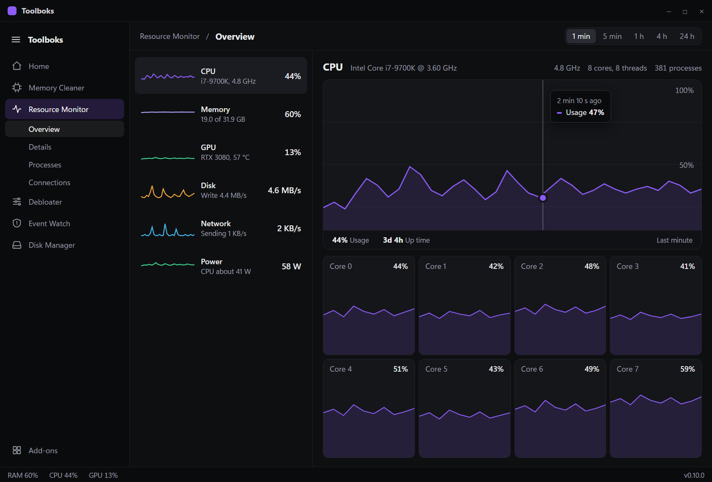
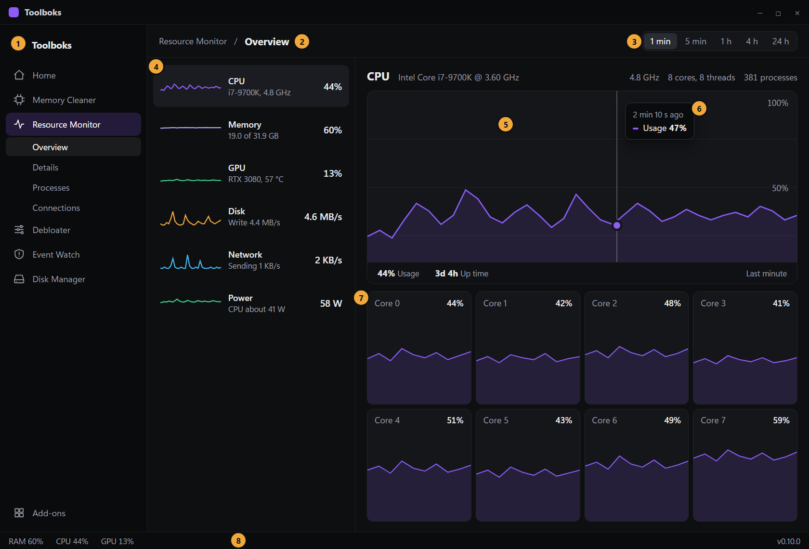
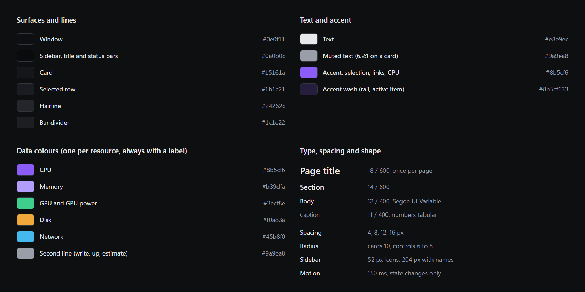

# Toolboks design system

The reference for how Toolboks looks and reads. The app, every built-in tool and every add-on follow it, so the whole product feels like one thing. Status: **adopted as the target** (direction H, chosen 2026-11-07); the app is being moved to it in the issues labelled `area: ui` (epic #24). Where the current app differs, this file wins.

Product facts (who it is for, what it must never do) live in the plan and the README. This file only records the visual and writing system.

## Character

Dark graphite, compact, calm. A tool you open for a minute next to a game or work, not a dashboard you stare at. The graph is the content, so chrome stays quiet: no glow, no gradients, no decorative icons, no coloured edges on cards. One accent (purple) marks selection and the CPU. Plain language first, the raw number one click away.

## Layout

- Window default 1120 x 760, resizable. Layout is structural: the sidebar collapses, lists and tables scroll, cards never shrink below their content.
- **Sidebar**: 52 px icon rail with a hamburger at the top; the hamburger opens it to 204 px with names, and the active tool's pages nest under it. State is in memory only. Order: Home, the built-in tools, add-ons, then Add-ons browser at the bottom.
- **Header** (46 px): breadcrumb `Tool / Page` at the left, page controls at the right (for graph pages the range switch 1 min, 5 min, 1 h, 4 h, 24 h). No second tab strip: pages live in the sidebar.
- **Status bar** (24 px): RAM, CPU, GPU, version. Tools may add short items; no more than three.
- **Content**: 16 px padding, 8 to 12 px gap between cards. Master and detail is the default for a page about several things (list on the left, 260 to 290 px; detail on the right).
- Spacing scale 4, 8, 12, 16. More space above a heading than below it.

## Tokens

| Role | Value |
|---|---|
| Window | `#0e0f11` |
| Sidebar, title bar, status bar | `#0a0b0c` |
| Card | `#15161a` |
| Selected row | `#1b1c21` |
| Hairline (card border, dividers) | `#24262c` |
| Bar divider | `#1c1e22` |
| Text | `#e8e9ec` |
| Muted text | `#9a9ea8` (6.2:1 on a card; never go darker) |
| Accent | `#8b5cf6`; wash `#8b5cf633` for the active sidebar item |

Data colours, one per resource, always shown next to a label (never colour alone): CPU `#8b5cf6`, Memory `#b39dfa`, GPU and GPU power `#3ecf8e`, Disk `#f0a83a`, Network `#45b8f0`, a second line (write, up, estimate) `#9a9ea8`. Status: ok `#3ecf8e`, watch `#f0a83a`, problem `#e5534b`.

- Elevation: declare it once, either a 1 px hairline or a soft shadow, never both. Cards use the hairline; only floating things (tooltips, menus) use a shadow with an offset and blur.
- Radius: cards 10, controls 6 to 8, pills fully round only for tiny chips.
- Selected row: a lighter fill. No coloured left or right border.

## Type

Windows system font (Segoe UI Variable). Sizes: 18 page title (once per page, 600), 14 section (600), 12 body, 11 caption. Numbers that change use tabular figures. Do not use a display face, monospace for decoration, or uppercase labels. Sentence case everywhere.

## Components

- **Graph card**: the graph fills the whole card; title top left, detail top right, a slim bottom bar with the numbers (value then small label). Hover shows a guide line, a dot on every line, and a tooltip with the time ("2 min 10 s ago") and each value. Estimates are labelled "estimate" in the bar and the tooltip.
- **Resource row** (master list): small line, name, one plain detail line, current value. Selected = lighter fill.
- **Stat**: value in 600, label in muted 11, inline in the bar. No big-number-over-label hero blocks.
- **Pill / segmented switch**: small choices of one group (the range switch). Selected = lighter fill and full-strength text.
- **Switch**: on/off for settings. Accent when on.
- **Table**: sticky header, 26 to 30 px rows, striped by hairline not fill, selection fill, right-aligned numbers.
- **Button**: one primary per view (accent fill), others outlined. Verbs, not "OK". Destructive actions say what they do and ask once.
- **Banner**: one line, muted, dismissible, no icon. Used for honest limits (for example "CPU temperature is not shown").
- **Tooltip / menu**: the only shadowed surfaces.
- **Empty and error states**: say what happened and what to do next, in plain words.

## States

Every interactive element has default, hover, focus (visible ring in the accent), active, disabled and, where it loads, a loading state. Skeleton or a quiet "Collecting..." line, never a spinner in the middle of content. Motion is 150 ms and only for state changes.

## Writing

- Plain, non-technical. Say what the thing does for the person, then offer detail.
- Measurements are measurements; estimates say "estimate". Say plainly what cannot be measured and why.
- Controls name their action. Errors name the problem and the recovery.
- Never claim a safety guarantee the tool does not give. Anything that changes the system shows a preview, asks for confirmation and offers undo.

## Accessibility

Text at least 4.5:1, large text 3:1. Nothing is conveyed by colour alone (data lines are labelled, status has a word). Everything is reachable by keyboard with a visible focus ring. Test at 125 to 200 percent scaling and at the smallest window size.

## Native notes (egui)

The mockups are web; the app is native egui. Tokens live in `ui::apply_style` and the shared helpers in `src/ui.rs` (`graph_card`, `pill`, `card`, `toggle_switch`). Build new pages from those helpers; do not restyle widgets per page. Nothing here may write to disk: sidebar state, selected resource and range are in memory.

## For add-on authors

An add-on renders inside the host workspace, so it inherits the shell: sidebar entry, header and breadcrumb, status bar and the tokens above.

- Use the SDK's standard page parts (headings, notes, metrics, preference controls) before anything custom; they already follow this file.
- A native add-on draws with the host's helpers (graph card, resource row, stat, table, button) and the tokens. Do not bring your own palette, font, corner radius or icon style.
- Pick your accent from the manifest's accent options; the accent is used for selection only. Data colours must be distinct from the accent and always labelled.
- Icons: 1.7 px stroke, 24 px grid, rounded caps and joins, drawn in the host's icon style. No emoji or Unicode glyphs as icons.
- Page types: **overview** (cards or master and detail), **table** (list with filters), **settings** (labelled controls), **tool** (preview, confirm, apply, undo). Name pages with one or two words; they appear in the sidebar under your add-on.
- Follow the writing rules: plain words, estimates labelled, destructive actions confirmed.
- Reference implementations: Resource Monitor (master and detail, graphs), Event Watch (table and inspector), Debloater (tool with preview and undo), Disk Manager (scan and map).

## Do not

Glow or neon edges, gradient text, glass or blur, coloured side borders on cards, cards inside cards, icon-plus-heading-plus-text card grids, hero metric blocks, uppercase micro-labels, emoji, a second accent colour, a modal where a panel will do.
