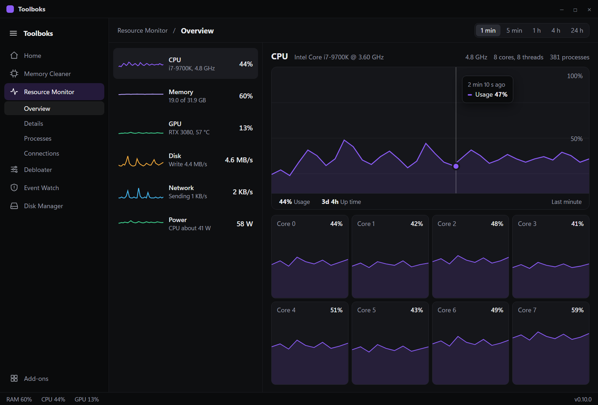
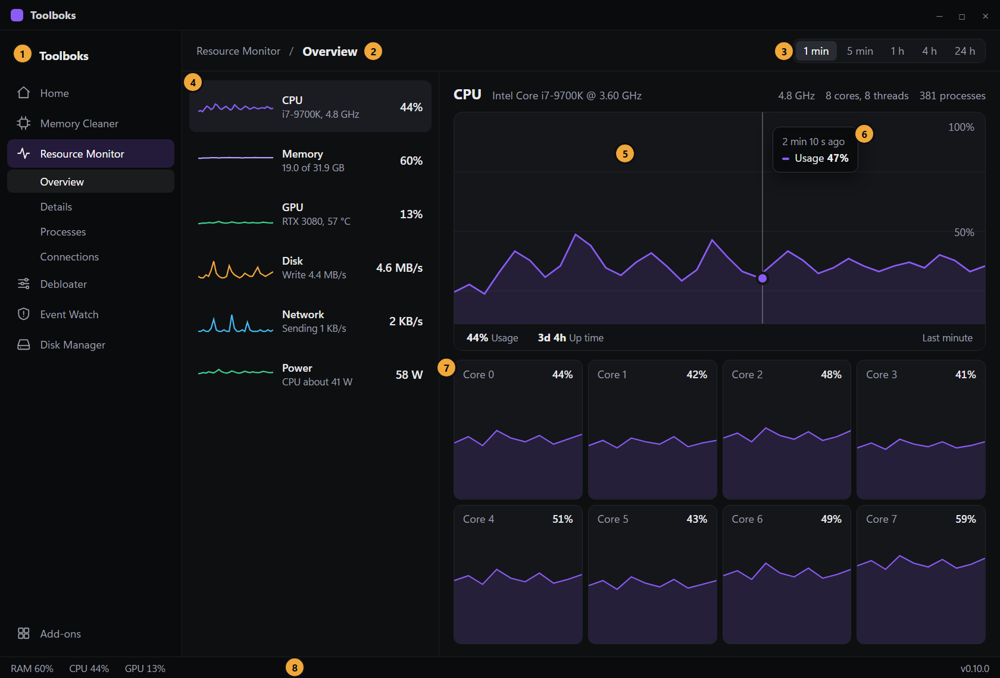
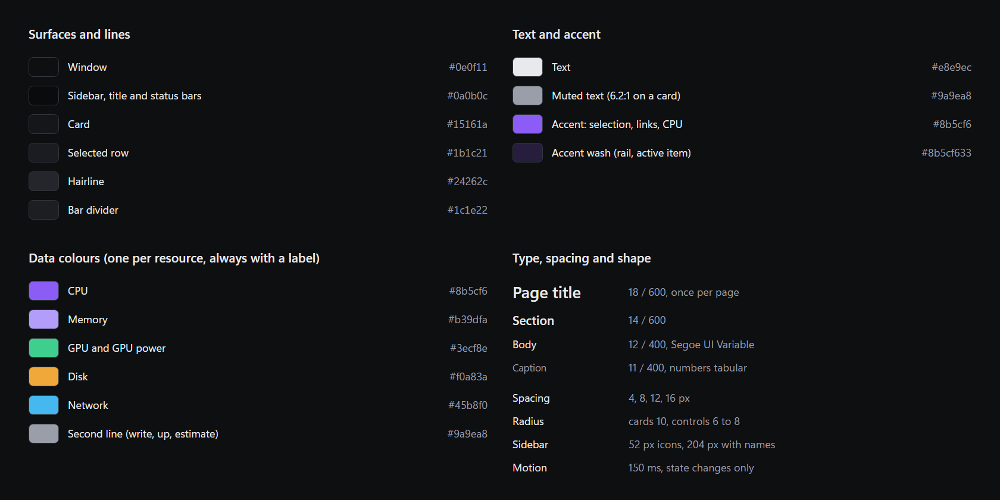

# Toolboks design system

The reference for how Toolboks looks and reads. The app, every built-in tool and every add-on follow it, so the whole product feels like one thing. Status: **adopted as the target** (direction H, chosen 2026-11-07); the app is being moved to it in the issues labelled `area: ui` (epic #24). Where the current app differs, this file wins.

Product facts (who it is for, what it must never do) live in the plan and the README. This file only records the visual and writing system.

## Character

Dark graphite, compact, calm. A tool you open for a minute next to a game or work, not a dashboard you stare at. The graph is the content, so chrome stays quiet: no glow, no gradients, no decorative icons, no coloured edges on cards. One accent (purple) marks selection and the CPU. Plain language first, the raw number one click away.

## Layout

- Window default 1540 x 960, resizable. Layout is structural: the sidebar collapses, lists and tables scroll, cards never shrink below their content.
- **Supported minimum: 1060 x 720 points** (`MIN_INNER_SIZE` in `src/app.rs`; the window cannot be made smaller). Sizes are points, so Windows display scaling does not reduce them; there is no 800 x 560 target. At the minimum the content area is at least 820 points wide next to the open sidebar, and the header never overlaps itself: the add-on browser's buttons collapse into an "Add-on actions" menu, and an add-on's page tabs into a "Pages" menu, when they would not fit the width that is left (measured, not a fixed window width).
- **Sidebar**: 52 px icon rail with a hamburger at the top; the hamburger opens it to 240 px with names (wider than the first mockup, which was 204 px: names such as "Resource Monitor" and the "New" tag need the room, and it suits the wider default windows), and the active tool's pages nest under it. State is in memory only. Order, top to bottom and also the Tab order: hamburger, Home, add-ons (an open add-on's pages nested under it), then at the foot Settings, Add-ons and, while that entry is open, its "Pick your tools" page. With the sidebar collapsed, a row's name shows as a tooltip on hover and on keyboard focus.
- **Sidebar rows**: add-on rows can be dragged to re-order and put in groups (a group header is a row: chevron, name, count; `layers` glyph in the rail). Rows that can be dragged show a six-dot grip at the right end on hover (the New/Update tag sits left of it). A dragged row swaps with the row the pointer enters; the carried row is see-through, the insertion mark is a 2 px accent line drawn on top, and a drop on a group header outlines it in the accent. The last row of the list is a muted "New group" row (`plus` glyph; icon with a tooltip in the rail) that opens the name window. Alt+Up/Down moves the focused row. Right-click or the menu key opens the row menu. Layout is saved in `Config.sidebar_layout`.
- **Header** (46 px): breadcrumb `Tool / Page` at the left, page controls at the right (for graph pages the range switch 1 min, 5 min, 1 h, 4 h, 24 h). No second tab strip: pages live in the sidebar.
- **Status bar** (24 px): RAM, CPU, GPU, version. Tools may add short items; no more than three.
- **Content**: 16 px padding, 8 to 12 px gap between cards. Master and detail is the default for a page about several things (list on the left, 260 to 290 px; detail on the right).
- Spacing scale 4, 8, 12, 16. More space above a heading than below it.

## Tokens

| Role | Value |
|---|---|
| Window | `#0e0f11` |
| Sidebar, title bar, status bar | `#0a0b0c` |
| Card | `#15161a` |
| Selected row | `#1b1c21` |
| Hairline (card border, dividers) | `#24262c` |
| Bar divider | `#1c1e22` |
| Text | `#e8e9ec` |
| Muted text | `#9a9ea8` (6.2:1 on a card; never go darker) |
| Accent | `#8b5cf6` for fills, selection, rings and graph lines; wash `#8b5cf633` for the active sidebar item |
| Accent text | `#b39dfa` for text-sized accent on a card (4.5:1; the plain accent is 4.3:1 and fails for small text) |

Data colours, one per resource, always shown next to a label (never colour alone): CPU `#8b5cf6`, Memory `#b39dfa`, GPU and GPU power `#3ecf8e`, Disk `#f0a83a`, Network `#45b8f0`, a second line (write, up, estimate) `#9a9ea8`. Status: ok `#3ecf8e`, watch `#f0a83a`, problem `#e5534b`.

- Elevation: declare it once, either a 1 px hairline or a soft shadow, never both. Cards use the hairline; only floating things (tooltips, menus) use a shadow with an offset and blur.
- Radius: cards 10, controls 6 to 8, pills fully round only for tiny chips.
- Selected row: a lighter fill. No coloured left or right border.

## Type

Windows system font (Segoe UI Variable). Sizes: 18 page title (once per page, 600), 14 section (600), 12 body, 11 caption. Numbers that change should use tabular figures where the toolkit allows; egui has no tabular-figure setting, so keep value columns right-aligned with a fixed width so they do not jump. Do not use a display face, monospace for decoration, or uppercase labels. Sentence case everywhere.

## Components

- **Graph card**: the graph fills the whole card; title top left, detail top right, a slim bottom bar with the numbers (value then small label). Hover shows a guide line, a dot on every line, and a tooltip with the time ("2 min 10 s ago") and each value. Estimates are labelled "estimate" in the bar and the tooltip.
- **Resource row** (master list): small line, name, one plain detail line, current value. Selected = lighter fill.
- **Verdict row** (Memory Cleaner Home): a status dot, the verdict at 18 and one plain sentence, and at the right the page's one action with an honest sub-line. The action is outlined until the state is bad; then it takes the accent fill.
- **Focus card** (Home health, `src/app/health.rs`): Home's health part follows this layout (the owner's "D Focus" design, 2026-11-16). At most 1000 points wide. Header: "Home" at 18/600 with a muted 12 px caption beside it ("Health, 11 checks, last result just now", or "… Checking…" after **Check again**), **Check again** outlined at the right. Then one card (radius 10, hairline, padding 28 x 24) for the attention finding to start with (the first Problem, else the first Watch): a 9 px status dot, the status word at 13/600 in its colour and a muted "· Start here"; the title at **28/600** (the one allowed exception to the type scale, only on this card); the observation at 15; the finding's evidence picture; then "Why it matters" and "What to do" (the `Instruction` text) as two columns, 14/600 heading over 14 px muted text, each only when the finding has that text (stacked under 560 points); a footer with the muted "<Add-on>, checked <freshness>" at the left and the action at the right, 32 tall (accent fill for a Problem, outlined for a Watch: one primary per view). **Evidence**: a bar (10 tall, round ends, hairline-coloured track) or a strip of up to 24 columns (empty columns are a 4 px stub), in the status colour (Problem `#e5534b`, Watch `#f0a83a`, OK `#3ecf8e`), always with its two labels under it at 12 muted, which carry the numbers. "Also worth a look" (14/600): the other attention rows as compact cards (padding 20 x 16): a 10 px dot, the title at 14/600 with the status word at 12/600 in its colour, the observation and source in 12 muted, a 200 px evidence strip with 11 px labels, and the outlined action, centred on the text; under 560 points the strip and the action move under the text. "N more from <add-on>" links under them. "Everything else is fine" (14/600; "Checked and fine" when nothing needs attention or some rows have no current result): one card with one column per add-on (at least 240 wide, wrapping), the add-on at 13/600, then one row per OK finding: a 6 px green dot, the title muted at 12, and the value at 12 at the right (the observation when it is at most 24 characters, else nothing; freshness on hover). Not checked, Unavailable and Out of date rows follow under "Without a current result" as quiet one-line Health rows (below). With nothing needing attention there is no focus card: a plain 15 px line "Nothing needs attention in what was checked." (or "No add-on has a current result yet."), the fine card, the quiet rows and the footer "Toolboks checks only what your add-ons measure." No score, no ring, no glow, no animation beyond the 150 ms state changes. The restore and update banners and "Pick your tools" sit between the header and the focus card.
- **Health row** (quiet rows on Home, `src/app/health.rs`): one finding without a current result (Not checked, Unavailable, Out of date), inside one card under "Without a current result"; rows are separated by hairlines, never cards. Each is one 28 px line: an 84 px status column with the word at 11 in muted and no dot, the title at 12/600, then the reason, source and freshness at 11 muted ("Needs administrator rights · Disk Manager", "checked 3 h ago · Event Watch is not running"). An action sits at the right, outlined; under 560 points of row width it moves under the text. Freshness everywhere on Home reads "checked just now", "4 min ago", "2 h ago", "3 days ago" and Home repaints it every 30 s while shown.
- **Pressure line**: a dashed amber reference line on a percent graph, labelled in the title row ("Pressure starts here (90%)"), drawn over `graph_card`.
- **Disclosure row**: a quiet row at the bottom of a master list (drawn chevron, lighter fill when open) that swaps the detail pane for the advanced tools. Selecting a resource closes it.
- **Stat**: value in 600, label in muted 11, inline in the bar. No big-number-over-label hero blocks.
- **Pill / segmented switch**: small choices of one group (the range switch). Selected = lighter fill and full-strength text.
- **Switch**: on/off for settings. Accent when on.
- **Table**: sticky header, 26 to 30 px rows, striped by hairline not fill, selection fill, right-aligned numbers.
- **Button**: one primary per view (accent fill), others outlined. Verbs, not "OK". Destructive actions say what they do and ask once.
- **Banner**: one line, muted, dismissible, no icon. Used for honest limits (for example "CPU temperature is not shown").
- **Tooltip / menu**: the only shadowed surfaces.
- **Empty and error states**: say what happened and what to do next, in plain words.

## States

Every interactive element has default, hover, focus (visible ring in the accent), active, disabled and, where it loads, a loading state. Skeleton or a quiet "Collecting..." line, never a spinner in the middle of content. Motion is 150 ms and only for state changes.

## Writing

- Plain, non-technical. Say what the thing does for the person, then offer detail.
- Measurements are measurements; estimates say "estimate". Say plainly what cannot be measured and why.
- Controls name their action. Errors name the problem and the recovery.
- Never claim a safety guarantee the tool does not give. Anything that changes the system shows a preview, asks for confirmation and offers undo.

## Accessibility

Text at least 4.5:1, large text 3:1. Nothing is conveyed by colour alone (data lines are labelled, status has a word). Everything is reachable by keyboard with a visible focus ring. Test at 125 to 200 percent scaling and at the smallest window size.

## Native notes (egui)

The mockups are web; the app is native egui. Tokens live in `ui::apply_style` and the shared helpers in `shared/toolboks-shared/src/ui.rs` (`toolboks_shared::ui`: `graph_card`, `pill`, `card`, `toggle_switch`), which the host and every add-on use. Build new pages from those helpers; do not restyle widgets per page. What is written to disk (decision, issue #52, 2026-11-16): the host keeps only its own settings, and the sidebar state, the selected resource and the range stay in memory. An add-on may keep data the person benefits from in its own data folder (`addon-data/<id>`), and only these kinds: its saved settings, what the person asked it to save (reports, macros, saved scans), safety data that undoes its own changes (the Debloater undo list, the gaming profile recovery folder), and Resource Monitor's resource history (on by default, 7 days, one switch to turn it off, a button to delete it). Every such file stays on the PC, is declared in the add-on's data note so the install review shows it, can be deleted from the add-on, and is deleted with the add-on when the person chooses to delete its data.

## For add-on authors

An add-on renders inside the host workspace, so it inherits the shell: sidebar entry, header and breadcrumb, status bar and the tokens above.

- Use the SDK's standard page parts (headings, notes, metrics, preference controls) before anything custom; they already follow this file.
- A native add-on draws with the host's helpers (graph card, resource row, stat, table, button) and the tokens. Do not bring your own palette, font, corner radius or icon style. An add-on built as its own exe calls `toolboks_shared::ui::apply_style` once so its process has the same fonts, colours and spacing; see the [author guide](docs/ADDON-AUTHOR-GUIDE.md).
- Pick your accent from the manifest's accent options; the accent is used for selection only. Data colours must be distinct from the accent and always labelled.
- Icons: 1.7 px stroke, 24 px grid, rounded caps and joins, drawn in the host's icon style. No emoji or Unicode glyphs as icons.
- Page types: **overview** (cards or master and detail), **table** (list with filters), **settings** (labelled controls), **tool** (preview, confirm, apply, undo). Name pages with one or two words; they appear in the sidebar under your add-on.
- Follow the writing rules: plain words, estimates labelled, destructive actions confirmed.
- Reference implementations: Resource Monitor (master and detail, graphs), Event Watch (table and inspector), Debloater (tool with preview and undo), Disk Manager (scan and map).

## Do not

Glow or neon edges, gradient text, glass or blur, coloured side borders on cards, cards inside cards, icon-plus-heading-plus-text card grids, hero metric blocks, uppercase micro-labels, emoji, a second accent colour, a modal where a panel will do.
