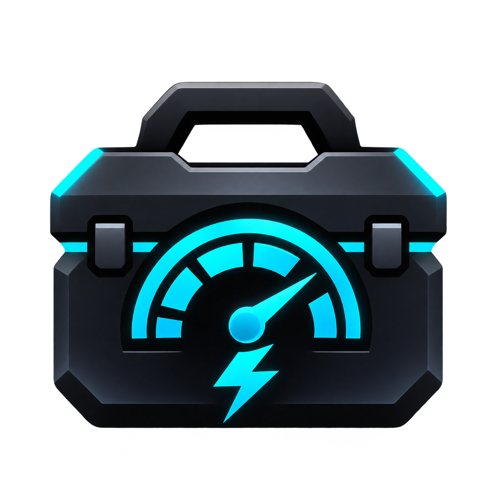

<p align="center">
  
</p>

<h1 align="center">Toolboks</h1>

<p align="center">
  <strong>One window for every Windows tool you actually use.</strong><br>
  One file to download. Tools you pick, install in seconds, update one by one, and remove without a trace.
</p>

<p align="center">
  <a href="https://github.com/Gusseti/toolboks/releases/latest"><strong>Download toolboks.exe</strong></a> ·
  <a href="docs/ADDON-ARCHITECTURE.md">How it works</a> ·
  <a href="sdk/README.md">Build an add-on</a> ·
  <a href="CHANGELOG.md">What's new</a>
</p>

---

## The idea

Your PC has a pile of small utilities: one for memory, one for disk space, one for the event log,
one for macros. Each has its own window, its own look and its own idea of what "safe" means.

Toolboks is the other way round. The app is an **empty shell**, written in Rust. Every tool is an
**add-on** that you pick from the add-on browser inside the app. Each add-on is its own program,
drawn inside the Toolboks window, so they all look and behave the same. They also can't take each
other down: if one crashes or hangs, the app keeps running and shows a plain message with a Restart button.

Install the ones you want. Skip the rest. Update or remove any of them on its own.

## What's on the shelf

| Add-on | What it does for you |
|---|---|
| **Disk Manager** | Scan a drive or folder and see where the space went. An interactive space map, a full-window **Space explorer** in the style of WizTree (pan, zoom, names on the tiles), largest files, a **duplicate finder** that lets you keep one copy and delete the rest, and a read-only scan that only remembers names and sizes. Defrag and TRIM are there too, behind an administrator prompt you confirm each time. Based on Stratum. |
| **Memory Cleaner** | A colored "where your memory goes" bar, grouped by app. Trim what idle apps hold on to, by hand or automatically when memory is really under pressure. Never closes an app. |
| **Resource Monitor** | Live graphs for processor, graphics, memory, disk and network, plus running apps, process priority and a history of what used what, and when. |
| **Event Watch** | The Windows event log in plain language, with a closer look at crashes, restarts and slow drivers. It reads. It never clears or changes anything. |
| **Debloater** | Privacy switches, startup entries and background tasks, explained one by one. Nothing changes until you pick it, and what you change can be undone. |
| **System Profiles** | A Windows gaming profile with a restore point, a registry backup and an activity log, so you can put things back. |
| **Macro Manager** | Record keyboard and mouse actions, edit the steps and mouse paths, replay them with repeat delays. Macros stay on your PC. [More](docs/MACRO-MANAGER.md). |
| **Audio Gainer** | Microphone gain, live level meters, listen to yourself, route your mic to other apps. Remembers settings per microphone. |
| **Testdeck** | For people who let AI coding agents run tests and builds: a small local queue so heavy jobs take turns instead of swamping the PC. The newest one, not yet marked verified. |

Disk Manager, Memory Cleaner, Resource Monitor and the rest live in the
[toolboks-addons](https://github.com/fredhakon/toolboks-addons) repository. The add-on list in the
app is read from there.

## What makes it feel like one app

- **One window, one look.** Dark graphite, one purple accent, plain words. Add-ons pick their
  content and pages, not their colors or fonts ([DESIGN.md](DESIGN.md)).
- **Your sidebar, your order.** Drag add-ons into the order you like, put them in named groups,
  collapse what you don't need. Tags show what is new or has an update.
- **Help that points.** Every add-on offers a full tour and a tour of the current page, with
  highlights you can cancel at any moment. A tour never clicks anything for you.
- **Tray and background.** Add-ons that need to keep working, like the history recorder or
  Testdeck, can run quietly in the tray while the window is closed.
- **Updates that you control.** The app checks GitHub once on launch. If there is a newer version,
  it asks. It downloads the file, checks its SHA-256 and swaps itself in place. Add-ons update
  on their own, one at a time.

## Rules every add-on lives by

1. **Plain words first**, the raw number one click away.
2. **Measured is measured**, and an estimate says it is an estimate.
3. **Nothing changes your system** without a preview, a confirmation and a way back.
4. **Administrator only when needed.** Add-on windows stay unelevated. An action that needs
   administrator rights goes through a separate helper with its own Confirm / Cancel window, and
   the install review lists in plain words what an add-on may do.

## Get it

1. Download `toolboks.exe` from the [latest release](https://github.com/Gusseti/toolboks/releases/latest).
   Checksum next to it (`toolboks.exe.sha256`).
2. Run it. It is a single file with no installer, for Windows 11.
3. Open the add-on browser and install what you want.

Releases aren't code-signed yet, so Windows SmartScreen may warn you the first time. Choose
**More info**, then **Run anyway**.

Preferences and installed add-ons are saved in `%LOCALAPPDATA%\Toolboks`. Opening and closing
Toolboks without changing anything writes nothing.

## Where it's going

Everything is an add-on, and the shell stays tiny. The tools come from the Toolboks team today.
The [add-on SDK](sdk/README.md) (a developer preview) is open to read and build against, but
publishing by anyone else is not open yet. That needs its own plan, and a sandbox, first. See
[ADDON-VISION.md](docs/ADDON-VISION.md).

## Build an add-on

Add-ons talk to the host over a small protocol and are drawn inside the same window.

- [SDK](sdk/README.md): manifest, validator, packager and a working starter
- [Architecture](docs/ADDON-ARCHITECTURE.md), [protocol](docs/ADDON-PROTOCOL.md) and
  [threat model](docs/ADDON-THREAT-MODEL.md)
- [Author guide](docs/ADDON-AUTHOR-GUIDE.md) and the [design checklist](docs/ADDON-DESIGN-CHECKLIST.md)

## Work on Toolboks itself

Build and run a preview that has its own window title and its own data folder, so it can sit next
to the real one. Details in [LOCAL-DEVELOPMENT.md](docs/LOCAL-DEVELOPMENT.md).

```powershell
cargo build --release --locked --features preview
```

Run the checks on your own PC before anything goes to `main`. There is no CI gate:

```powershell
cargo fmt --all --check
cargo clippy --workspace --all-targets --locked -- -D warnings
cargo test --workspace --locked -- --test-threads=1
```

**Branches.** Work goes into `staging` through pull requests. `main` is the stable branch, and
releases are cut from it. Merge `staging` into `main` when it is ready, with a merge commit.

**Releasing.** Versions follow [SemVer](https://semver.org) and live in `Cargo.toml`. Bump the
version (and `Cargo.lock`), run the checks, merge to `main`. `.github/workflows/release.yml` sees a
version with no release yet, builds `toolboks.exe` and publishes `vX.Y.Z` with exactly two files:
`toolboks.exe` and `toolboks.exe.sha256`. A push to `main` that does not change the version
releases nothing. Pre-releases (`vX.Y.Z-rc.N`) are published from tags with `scripts/release.ps1`;
the in-app updater ignores them. Versions 0.1.0 and 0.2.0 used long file names and cannot update
themselves: download `toolboks.exe` once from the latest release.

Dependabot opens weekly pull requests into `staging` for Cargo crates and GitHub Actions. Run the
checks on them before merging.

<details>
<summary>Audio Gainer: saved microphone settings</summary>

Audio Gainer's Settings section can enable your microphone when Toolboks starts, even when you open
another tool first. This is off by default. *Remember settings for each microphone* saves its on/off
state, gain, listening volume, output choices and routing locally. Saved activation restores when
switching microphones and when Toolboks launches. A saved per-microphone on/off state takes
precedence over the general startup switch; saved routing resumes with an enabled microphone.

Choose a microphone and use **Use selected microphone** under Default microphone to remember it by
name. Its name stays saved while disconnected, and Toolboks switches back when it reconnects.
Duplicate device names require a unique choice rather than automatically picking an arbitrary
microphone. Manually disabling the microphone keeps it off for that session.

Existing installations need to **Review update** in Audio Gainer to approve the new
local-preferences permission before using saved settings. Preferences stay in the Toolboks data
folder; preview builds keep a separate profile. VB-Audio Virtual Cable is installed separately for
routing to other apps.

</details>

## License

[MIT](LICENSE)
