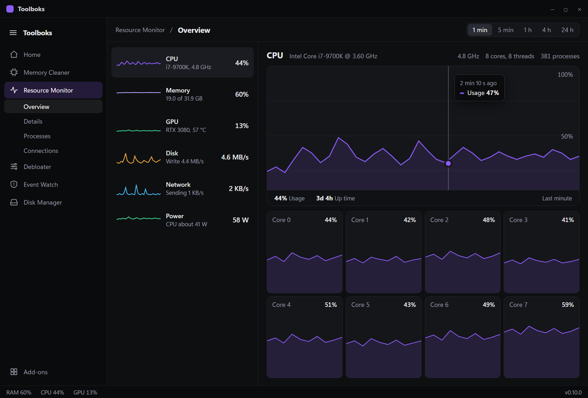
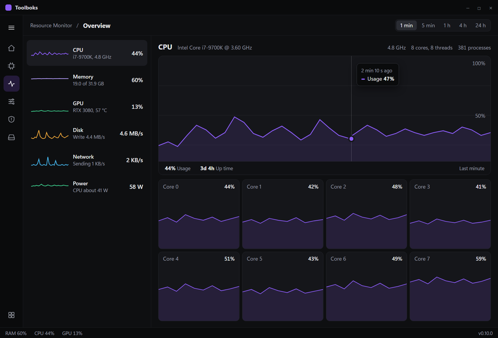
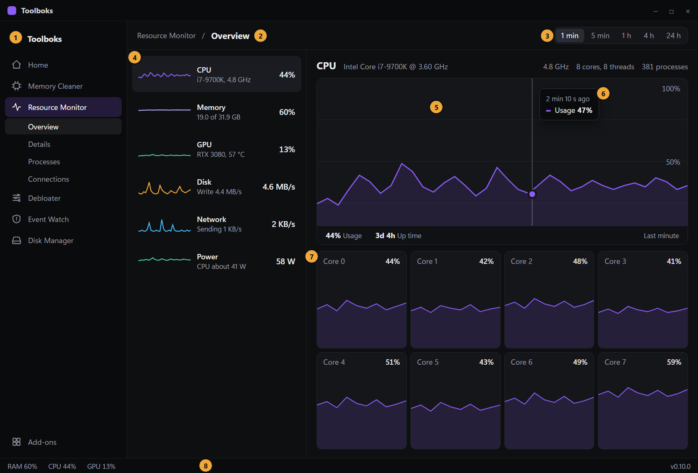
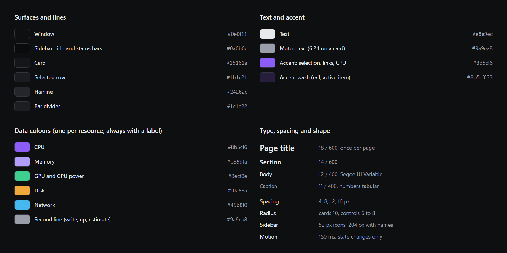

# Plan: UI redesign, direction H (master and detail)

Chosen by the owner on 2026-11-07 from nine directions on the design canvas. Plan only; nothing is built yet. Tracked in the GitHub issues labelled `area: ui` (epic #24).

**Scope: the whole app.** The shell, every built-in tool (Memory Cleaner, Resource Monitor, Debloater, Event Watch), Home, the add-on browser, Settings, the tray and update windows, and the add-ons (Disk Manager and the SDK templates). The visual system is recorded once in [DESIGN.md](../DESIGN.md) at the repo root; that file is the reference every later add-on follows.

## The design

Dark graphite, purple accent, compact. Sidebar is an icon rail with a hamburger button that opens it to show names (the open sidebar nests the pages of the active tool). The Resource Monitor Overview becomes a list of resources on the left and a large detail view on the right.

Expanded sidebar:

Collapsed sidebar (icons only):

Anatomy:

1. Hamburger: switches the sidebar between 52 px (icons) and 204 px (names). Remembered for the session only.
2. Breadcrumb: tool / page. The page title is the only 14 px bold text in the header.
3. Range switch: 1 min, 5 min, 1 h, 4 h, 24 h. Applies to every graph on the page.
4. Resource list: name, one plain line of detail, current value and a small line. The selected row has a lighter fill, never a coloured edge.
5. Detail graph: fills its card; the bottom bar carries the numbers.
6. Hover read-out: guide line, dot and a small tooltip with the time and the value.
7. Per-core graphs (CPU only; other resources show their own detail, see the slices).
8. Status bar: RAM, CPU, GPU and version.

## Tokens

Surfaces `#0e0f11`, bars `#0a0b0c`, card `#15161a`, selected row `#1b1c21`, hairline `#24262c`. Text `#e8e9ec`, muted `#9a9ea8` (contrast 6.2:1 on a card). Accent `#8b5cf6` for selection and CPU. One data colour per resource, always shown with a label. Type 18 / 14 / 12 / 11, tabular numbers, Windows system font. Radius 10 for cards, 6 to 8 for controls. Motion 150 ms, state changes only.

## Native notes (egui)

- The canvas mockups are web; the app stays native egui. Tokens go into `ui::apply_style` and `src/ui.rs`.
- The existing `graph_card`, hover read-out and range switch are reused; the new parts are the sidebar, the header and the master list.
- Do not add anything that writes to disk. The sidebar state is in memory.

## Slices

See the issues labelled `area: ui`. The order is: tokens, sidebar and header, Resource Monitor Overview, the other resource details, the remaining Resource Monitor pages, Memory Cleaner, Debloater, Event Watch, Home, add-on browser and Settings, the add-ons and SDK, then a quality pass.
